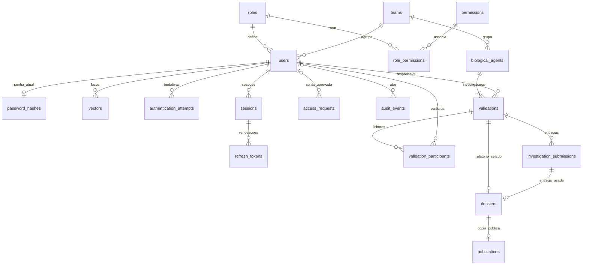

# Banco de dados alvo - consolidação documental

Este arquivo mostra as tabelas e campos que vamos usar. O funcionamento está em [BUSINESS_RULES.md](BUSINESS_RULES.md) e os contratos das rotas em [ENDPOINTS.md](ENDPOINTS.md), e o exemplo completo em [USE_CASES.md](USE_CASES.md). A [migration inicial](../migrations/001_initial_schema.sql) agora define essa estrutura para bancos novos. Isso não comprova que o banco do projeto já foi atualizado ou que os serviços foram implementados.

Editar a migration 001 não modifica um banco onde ela já está registrada. Para preservar dados existentes, a atualização exige uma migration posterior de conversão. A 001 inclui estados, limites, chaves, índices e proteção do conteúdo histórico; permissões, reserva de N2/N3, bloqueios transacionais e regras entre tabelas continuam sendo responsabilidade da implementação dos serviços. Os [testes SQL](../tests/test_initial_schema.sql) devem ser executados somente em um banco isolado com a 001 aplicada.

O banco alvo tem **18 tabelas**: 12 de contas, autorização e segurança; 6 do laboratório. Não é necessário adicionar uma tabela de rascunhos, uma de notícias em Markdown ou uma para cada nível.

## Como ler os nomes dos campos

`id` é o identificador; `user_id`, `agent_id` e outros nomes terminados em `_id` ligam registros. `created_at` é quando foi criado; `created_by`, quem criou. `updated_at/by` registram última alteração. `status` informa a situação daquele registro. `hash` permite verificar senha/token sem guardar o valor original. `snapshot` é uma cópia preservada do que foi entregue naquele momento. PK é a chave do registro; FK é o vínculo com outra tabela; UNIQUE impede duplicidade.

## Autoria e por que usamos ALTER TABLE depois de criar users

Os campos `created_by` e `updated_by` registram, respectivamente, quem criou o registro e quem fez sua última alteração. Eles apontam para o `id` de uma pessoa cadastrada em `users`. São usuários do sistema, como N1 ou ADMIN, e não contas de conexão do PostgreSQL.

Por exemplo: se Ana criar uma equipe, `teams.created_by` recebe o ID de Ana. Se Bruno alterar essa equipe depois, `teams.updated_by` recebe o ID de Bruno. A chave estrangeira impede gravar nesses campos um ID que não exista em `users`; o backend precisa identificar e preencher o autor correto.

Na migration, os vínculos de autoria de `roles` e `teams` são adicionados depois:

```sql
ALTER TABLE roles
    ADD FOREIGN KEY (created_by) REFERENCES users(id),
    ADD FOREIGN KEY (updated_by) REFERENCES users(id);

ALTER TABLE teams
    ADD FOREIGN KEY (created_by) REFERENCES users(id),
    ADD FOREIGN KEY (updated_by) REFERENCES users(id);
```

Essa ordem resolve uma dependência circular: `users` precisa de `roles` e `teams` para registrar o nível e a equipe de cada pessoa; essas duas tabelas precisam de `users` para vincular seus autores. Por isso:

1. Criamos `roles` e `teams` com os campos de autoria, ainda sem as chaves estrangeiras desses campos.
2. Criamos `users`, já ligada ao nível e à equipe.
3. Usamos `ALTER TABLE` para acrescentar os vínculos de autoria, agora que `users` existe.

Os campos de autoria dessas tabelas permitem `NULL` para cadastrar os níveis e equipes iniciais antes de existir o primeiro administrador. Isso evita inventar um autor para os registros iniciais. Não é um trigger: são vínculos verificados pelo banco ao gravar ou alterar os valores.

## Convenções

IDs UUID; instantes TIMESTAMPTZ; data de coleta DATE; flags BOOLEAN; hashes/textos TEXT; conteúdo criptografado BYTEA. Percentuais NUMERIC(5,2), entre 0 e 100, escolha desta consolidação. Limites de caracteres são validados no frontend/backend e protegidos no banco, sem truncamento automático. Datas de criação/alteração são geradas pelo sistema. Exclusão de uma conta/agente não deve apagar histórico em cascata; desativação é o fluxo normal.

## Contas, autorização e segurança - 12 tabelas

| Tabela | Campos | Regra principal |
| --- | --- | --- |
| `roles` | `id, code, name, description, created_at, created_by, updated_at, updated_by` | Códigos ADMIN/N1/N2/N3; código único, nomes por extenso na tela. |
| `permissions` | `id, code, description` | Uma ação identificada por código único. |
| `role_permissions` | `role_id, permission_id` | PK composta; associação muitos para muitos. |
| `teams` | `id, code, name, description, created_at, created_by, updated_at, updated_by` | Grupo administrativo, não classificação científica. Código único. |
| `users` | `id, name, email, role_id, team_id, status, biometric_enrollment_required, password_change_required, activated_at, disabled_at, disabled_by, created_at, created_by, updated_at, updated_by`; controles escolhidos `biometric_failure_count, biometric_failure_window_started_at, biometric_blocked_until` | Email normalizado único, inclusive desativados; N1/N2 têm grupo. Um N2 habilitado por grupo e um N3, incluindo reserva na ativação. |
| `access_requests` | `id, user_id?, requested_name, requested_email, temporary_password_hash?, requested_by, requested_role_id, requested_team_id?, status, created_at, decided_by?, decided_at?, rejection_reason?` | Conta só nasce na aprovação; hash somente enquanto pendente. Rejeição encerra o pedido. |
| `password_hashes` | `user_id, password_hash, is_temporary, temporary_expires_at?, updated_at, updated_by` | Uma credencial atual por usuário; PK/FK user_id; Argon2id. |
| `vectors` | `id, user_id, ciphertext, nonce, key_version, model_version, created_at` | Embedding AES-GCM; chave fora do banco; dimensão/serialização ainda dependem dos modelos. |
| `authentication_attempts` | `id, user_id, status, stage, token_jti, biometric_failures, created_at, expires_at, completed_at?`; campos adicionais `operation, initiating_session_id?` | Guarda autorização da etapa, não o JWT completo; expiração de cinco minutos por token emitido. |
| `sessions` | `id, user_id, created_at, expires_at, revoked_at?` | Prazo absoluto de 24 horas. |
| `refresh_tokens` | `id, session_id, token_hash, created_at, expires_at, used_at?, revoked_at?, replaced_by_id?` | Token aleatório, só hash persistido; rotação atômica, reutilização revoga sessão. |
| `audit_events` | `id, actor_id?, event, resource_type, resource_id?, success, reason?, request_id, created_at` | Eventos sanitizados; não copiar textos do cofre, motivos exclusivos N3, senhas, tokens ou embeddings para logs administrativos. |

A autorização central consulta papel/permissões e verifica grupo, vínculo, estado e recurso. Permissão configurável não remove as restrições do cofre. ADMIN não recebe acesso técnico automático. Constraints de unicidade entre pedidos/contas e reserva de cargos exigem desenho transacional, além de índices.

## Laboratório - 6 tabelas

### 1. `biological_agents` - cadastro do agente

| Campos | Tipo/limite | Uso |
| --- | --- | --- |
| `id, code` | UUID; código único gerado | Identidade do cadastro. |
| `provisional_label` | Texto até 120 | Identificação provisória obrigatória. |
| `material_type` | Texto até 100 | Material obrigatório. |
| `collection_location` | Texto até 255 | Local obrigatório. |
| `collected_on` | DATE | Data obrigatória; não futura. |
| `initial_observations, investigation_reason` | Texto até 1.500 cada | Obrigatórios no cadastro. |
| `known_information` | Texto opcional até 1.500 | O que já era conhecido antes da análise. |
| `team_id, created_by` | FKs | Grupo inicial e N1 criador. |
| `status` | ACTIVE/INACTIVE | Somente ativo ou inativo; independente da validação. |
| `created_at, updated_at, updated_by` | Datas/FK | Rastreio das alterações. |

Primeira validação nasce na mesma transação e fica com o N1 criador. Cadastro editável pelo criador autorizado ou N2 do grupo somente antes da primeira entrega. Depois fica preservado. Somente N2 ativa/desativa; desativação exige nenhuma validação em andamento. Inativos continuam consultáveis com filtro e mesmos acessos. Inativar não retira notícia.

### 2. `validations` - tarefa e formulário científico atual

| Campos | Tipo/limite | Uso |
| --- | --- | --- |
| `id, agent_id, team_id, responsible_user_id` | UUID/FKs | Agente, grupo e único N1 responsável. |
| `status` | OPEN/IN_REVIEW/RETURNED/REPORTED/PUBLISHED/CLOSED | Estado da tarefa. |
| `assessments_performed` | Texto até 1.500 | Avaliações realizadas. |
| `observed_results, technical_opinion, recommendation` | Texto até 5.000 cada | Resultados, parecer e recomendação. |
| `estimated_risk_percentage` | NUMERIC opcional 0–100 | Estimativa N1; nulo significa não determinado. |
| `created_at, created_by, updated_at, updated_by` | Datas/FKs | Abertura e alterações. |
| `closed_at?, closed_by?, closure_reason?, closure_cause?` | Datas/FK/texto | Motivo manual N2 até 1.500; causa distingue revisão encerrada, sigilo ou pedido N3. Motivos de sigilo permanecem protegidos no dossiê. |
| `previous_validation_id?` | FK para validação | Proposta de ligação quando a tarefa atende pedido N3. |

Rascunho usa os mesmos quatro textos, permitindo preenchimento parcial. Envio exige os quatro preenchidos; risco N1 é opcional. Somente responsável edita/envia. OPEN/RETURNED permitem compartilhar, remover colaboradores e trocar responsável conforme as permissões acordadas. Revisão trava o formulário; devolução reabre, preservando entregas anteriores.

Somente uma validação em andamento por agente: OPEN/RETURNED/IN_REVIEW/REPORTED ocupam vaga; CLOSED/PUBLISHED liberam. Agente deve estar ativo para nova tarefa. N2 cria as posteriores e atribui N1 ativo do grupo. N2 só encerra manualmente em IN_REVIEW, com motivo visível à equipe autorizada. Envio ao N3 mantém a vaga.

### 3. `validation_participants` - colaboradores em leitura

Campos: `validation_id, user_id, added_by, added_at`; PK composta `(validation_id,user_id)`, FKs para validação e usuários.

Vínculo representa somente leitura. N1 responsável ou N2 do grupo inclui N1 ativo do mesmo grupo em OPEN/RETURNED. Somente N2 remove. Somente N2 troca o responsável, nesses estados; anterior passa a colaborador leitor. Remoção do vínculo atual não modifica snapshots das entregas. Auditoria registra inclusões/remoções/trocas; não é preciso dar uma flag de edição a cada participante.

### 4. `investigation_submissions` - entregas preservadas

Campos: `id, validation_id, submission_number, responsible_user_id, submitted_by, submitted_at, assessments_performed, observed_results, technical_opinion, recommendation, estimated_risk_percentage?, participants_snapshot`, mais `returned_by?, returned_at?, return_reason?`.

Conteúdo científico e participantes são copiados no envio e preservados. `participants_snapshot` em JSONB é a escolha simples para IDs e identificação histórica necessária, sem credenciais; conteúdo definido abaixo. Número crescente por validação com unicidade `(validation_id,submission_number)`. Devolução N2 em IN_REVIEW registra motivo obrigatório até 1.500, disponível à equipe autorizada, sem sobrescrever a análise recebida. Novo envio gera outra entrega.

### 5. `dossiers` - relatório interno e ficha no cofre

| Campos | Uso |
| --- | --- |
| `id, validation_id, source_submission_id, protocol` | Validação única, entrega usada, protocolo único. |
| `sent_by, sent_at, received_snapshot` | Autoria, data e cópia da análise/equipe recebida; JSONB. |
| `title, final_conclusion, final_risk_percentage` | Relatório interno completo; todos obrigatórios. Título 120/conclusão 5.000 são os limites escolhidos para revisão. |
| `public_title, public_subtitle?, public_risk_category, public_body` | Ficha junto do relatório: 120, 200 opcional, LOW/MODERATE/HIGH, corpo 5.000. |
| `decision_status, decided_by?, decided_at?, restricted_reason?` | Decisão separada do conteúdo original; sigilo com motivo até 1.500 somente N3. Estados: WAITING_N3, PUBLISHED, RESTRICTED, NEW_VALIDATION_REQUESTED. |
| `new_validation_requested_by?, new_validation_requested_at?, new_validation_request_reason?, request_fulfilled_by_validation_id?` | Proposta de guardar o pedido N3 sem tabela adicional; motivo até 1.500 e vínculo à tarefa que o atendeu. |

Conteúdo selado não é editado; apenas metadados de decisão/pedido evoluem. Só N3 lê conteúdo completo. N2 consulta título, agente, protocolo e situação por projeção específica; não recebe conclusão, percentual, ficha ou snapshot.

Pedido N3 encerra a anterior, preserva o dossiê e libera nova tarefa. N2 recebe pedido/motivo e atribui a próxima; nova equipe vê esse motivo sem acesso ao cofre. Guardar pedido e atendimento nessas colunas é a escolha de persistência desta consolidação, para sua revisão. Pedido não atendido tem vínculo de atendimento nulo; preenchê-lo na criação da nova tarefa, impedindo atendimento duplicado ou vínculo a tarefa incompatível. Motivo de sigilo não deve ser copiado para `validations.closure_reason`.

### 6. `publications` - cópia pública aprovada

Campos: `id, dossier_id, public_title, public_subtitle?, public_risk_category, public_body, status, published_by, published_at, withdrawn_by?, withdrawn_at?, withdrawal_reason?`.

FK única privada para dossiê. Publicação copia somente os campos públicos aprovados e passa a validação de origem para PUBLISHED atomicamente. Publico consulta apenas registros publicados; não recebe dossiê, equipe, risco interno, local exato nem motivo de retirada. Retirada preserva conteúdo/histórico e exige motivo até 1.500 consultável somente N3; não reabre validação nem afeta outra tarefa.

## Relações e garantias

- Papel → vários usuários; papel ↔ permissões via associação; grupo → seus usuários e agentes.
- Usuário → uma senha atual, vários embeddings, tentativas e sessões; sessão → cadeia de refresh tokens.
- Agente → várias validações, uma em andamento; validação → um responsável, vários colaboradores e entregas.
- Validação → no máximo um dossiê; dossiê → no máximo uma publicação.
- Conteúdo de entrega e dossiê preservado; cadastro bloqueado após primeira entrega.
- Transações para cadastro/primeira tarefa, envio/snapshot, troca do responsável/participante, encerramento, publicação/sigilo/pedido e criação da tarefa seguinte.
- Consultas aplicam escopo inclusive em totais e filtros. Históricos não restauram vínculo de acesso removido.

## Como os vínculos ficam no banco



A figura mostra relações principais; as várias colunas de autoria também apontam para users. A primeira validação nasce junto do agente, portanto o cadastro completo tem pelo menos uma tarefa. Pedido novo pode ligar um dossiê a uma validação posterior do MESMO agente; esse vínculo é conferido no serviço e na transação.

## Campos vazios, estados e garantias escolhidas

O símbolo `?` nas listas significa que o campo pode ficar vazio. Campos de rascunho podem ser nulos até o envio. Textos exigidos em uma transição devem conter algo além de espaços; não aparar nem modificar senhas. FKs de autoria criada pelo bootstrap podem ficar nulas antes de existir ADMIN, sem criar autor fictício. As demais autorias de ações autenticadas são obrigatórias.

| Onde | Valores e conferências |
| --- | --- |
| users.status | PENDING_ACTIVATION, ACTIVE, DISABLED. Recuperação pode exigir etapa mesmo com conta habilitada; flags controlam emissão da sessão. |
| access_requests.status | PENDING, APPROVED, REJECTED. Hash só PENDING; decisão/autor/data obrigatórios em APPROVED/REJECTED. user_id só APPROVED. |
| biological_agents.status | ACTIVE ou INACTIVE. Cadastro nasce ACTIVE. |
| validations.status | OPEN, IN_REVIEW, RETURNED, REPORTED, PUBLISHED, CLOSED. |
| authentication_attempts.status | PENDING, BLOCKED, COMPLETED, CANCELLED. Prazo expirado é verificado por expires_at; não precisa tarefa cron. |
| authentication_attempts.stage | ENROLL_FACE, VERIFY_FACE, CHANGE_PASSWORD. |
| authentication_attempts.operation | LOGIN, ACTIVATION, RECOVERY, PASSWORD_CHANGE. initiating_session_id obrigatório para troca voluntária. |
| dossiers.decision_status | WAITING_N3, PUBLISHED, RESTRICTED, NEW_VALIDATION_REQUESTED. Uma decisão terminal; não pedir nova tarefa e publicar o mesmo dossiê depois. |
| publications.status | PUBLISHED ou WITHDRAWN. Retirada não reescreve a decisão histórica do dossiê. |
| public_risk_category | LOW, MODERATE, HIGH; rótulos baixo, moderado, alto. |
| closure_cause | N2_CLOSED, N3_RESTRICTED, N3_NEW_VALIDATION. closure_reason só guarda o motivo N2; motivos reservados N3 não são copiados. |

Campos de risco são NUMERIC(5,2), nunca float para persistir. Timestamps de expiração/uso/revogação são verificações do servidor, sem confiar em datas do navegador. UUIDs/FKs obrigatórios para agente/grupo/responsável; não inferir que o criador permanece responsável para sempre.

Snapshot de entrega: lista de `{user_id,name,role_code}` do responsável e dos colaboradores, mais ID/nome do remetente e os quatro textos/risco. O snapshot do dossiê incorpora a entrega usada, identificação cadastral da amostra e conclusão/ficha recebidas. Não guardar credenciais. JSONB é usado SOMENTE nessas cópias históricas; dados editáveis e vínculos continuam em colunas/FKs. Decisão e motivo pertencem a metadados fora do snapshot imutável.

| Garantia | Como proteger |
| --- | --- |
| Email único | UNIQUE users.email normalizado; UNIQUE parcial pedido pendente por requested_email; bloqueio transacional por email em todos os fluxos que disputam conta/pedido. |
| Uma vaga N2/N3 | Bloquear grupo para N2 e posição global para N3; conferir papel/reserva em users antes de aprovar, reativar ou promover. Constraint envolvendo roles precisa migração específica ou trigger; não presumir que índice parcial com JOIN existe. |
| Uma tarefa ativa por agente | Índice UNIQUE parcial em validations(agent_id) para OPEN/IN_REVIEW/RETURNED/REPORTED, mais bloqueio do agente em criação/envio/decisão/inativação. |
| Um dossiê/publicação | UNIQUE dossiers.validation_id, dossiers.source_submission_id, dossiers.protocol e publications.dossier_id. |
| Participação sem duplicata | PK validation_participants(validation_id,user_id); responsável não precisa vínculo de colaborador paralelo. Troca remove vínculo leitor do novo responsável, inclui anterior sem duplicar. |
| Uma senha atual | PK/FK password_hashes.user_id. |
| Refresh sem reutilização | UNIQUE token_hash; bloquear sessão/token e registrar sucessor/used_at na rotação. |
| Entregas numeradas | UNIQUE (validation_id,submission_number); alocar número dentro do bloqueio da tarefa. |
| Pedido N3 atendido uma vez | UNIQUE no request_fulfilled_by_validation_id não nulo e previous_validation_id não nulo; bloquear dossiê/agente e gravar ambos os lados em uma transação. Apenas ciclos que atendem pedido usam previous_validation_id. |
| Imutabilidade | Não permitir alteração dos campos de conteúdo de entrega/dossiê/publicação depois do envio/aprovação; atualizar apenas metadados autorizados. Proteger no serviço e por trigger do banco, com migração administrativa separada. |
| Desativação sem tarefa pendente | Bloqueio do agente compartilhado por criação/inativação e conferir estados; CHECK simples não consulta tabela vizinha. |

Sem cascata de exclusão em conta, agente, tarefa, entregas ou dossiês. Auditoria registra atribuição/remoção sem dar acesso ao cofre. Índices de consulta: users(team_id,status), access_requests(requested_by,status), biological_agents(team_id,status), validations(agent_id,status), validations(responsible_user_id,status), validation_participants(user_id), dossiers(decision_status,sent_at), publications(status,published_at). Datas/FKs de autoria opcionais por estado recebem CHECKs na migration inicial.

## Relação com as respostas da API

A tabela inteira nunca vira resposta. Exemplo: card N2 recebe título/agente/situação/protocolo; ficha pública recebe só título/subtítulo/categoria/corpo/data. Dossiê contém motivo de sigilo, mas ele não aparece em card N2. Pedido de nova validação é compartilhado de forma explícita com N2 e nova equipe. Motivo de retirada não vai ao público. Veja as projeções em [ENDPOINTS.md](ENDPOINTS.md).

## O que realmente depende dos testes dos modelos

Dimensão/serialização dos embeddings, versão compatível, quantidade e intervalo de frames, recorte, resolução interna e limiares. O desenho do banco não exige uma coluna para cada versão de modelo; vectors já registra versão e conteúdo criptografado. Tetos de upload são escolhas iniciais de operação, não precisão biométrica comprovada.
