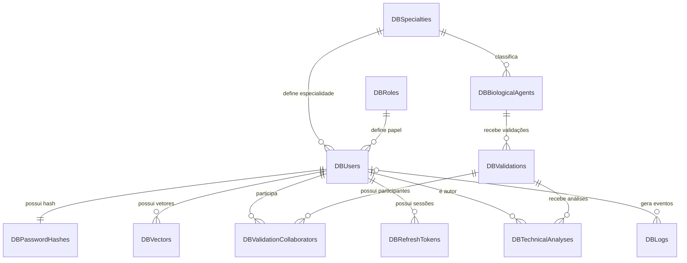

# Banco de Dados

## Escopo atual

Este documento registra usuários, papéis, especialidades, autenticação, biometria, auditoria e o fluxo técnico de validação. As tabelas de relatórios, cofre e publicações serão definidas posteriormente.

## Campos de auditoria

As tabelas mutáveis repetem estes campos no SQL manual. Eles não formam uma tabela própria no banco.

| Campo | Tipo | Regra |
| --- | --- | --- |
| `id` | `UUID` | Chave primária. |
| `created_at` | `TIMESTAMPTZ` | Obrigatório. |
| `created_by` | `UUID` | Usuário que criou o registro; nulo apenas em ações automáticas ou dados iniciais. |
| `updated_at` | `TIMESTAMPTZ` | Data da última alteração. |
| `updated_by` | `UUID` | Usuário que fez a última alteração. |
| `soft_delete` | `BOOLEAN` | `FALSE` por padrão. |
| `deleted_at` | `TIMESTAMPTZ` | Data da exclusão lógica. |
| `deleted_by` | `UUID` | Usuário que realizou a exclusão lógica. |

## Tabelas

### DBRoles

Define o papel e o nível institucional do usuário.

| Campo | Tipo | Regra |
| --- | --- | --- |
| campos de auditoria | conforme seção anterior | Aplicáveis. |
| `code` | `VARCHAR(30)` | Único e obrigatório. Exemplos: `N1_TECNICO`, `N2_DIRETOR`, `N3_MINISTRO`. |
| `name` | `VARCHAR(80)` | Obrigatório. |
| `level` | `SMALLINT` | Obrigatório; valores 1, 2 ou 3. |
| `description` | `VARCHAR(255)` | Opcional. |

### DBSpecialties

Define as áreas técnicas do laboratório.

| Campo | Tipo | Regra |
| --- | --- | --- |
| campos de auditoria | conforme seção anterior | Aplicáveis. |
| `code` | `VARCHAR(50)` | Único e obrigatório. |
| `name` | `VARCHAR(120)` | Obrigatório. |
| `description` | `VARCHAR(255)` | Opcional. |

### DBUsers

Identifica o usuário e o vincula a um papel e, quando aplicável, a uma especialidade.

| Campo | Tipo | Regra |
| --- | --- | --- |
| campos de auditoria | conforme seção anterior | Aplicáveis. |
| `role_id` | `UUID` | Obrigatório; FK para `DBRoles.id`. |
| `specialty_id` | `UUID` | Opcional; FK para `DBSpecialties.id`. N1 e N2 devem possuir especialidade; N3 não precisa dela. |
| `name` | `VARCHAR(150)` | Obrigatório. |
| `email` | `VARCHAR(254)` | Único e obrigatório. |

### DBPasswordHashes

Guarda apenas o hash atual da senha. Nunca armazena a senha original.

| Campo | Tipo | Regra |
| --- | --- | --- |
| campos de auditoria | conforme seção anterior | Aplicáveis. |
| `user_id` | `UUID` | Único, obrigatório; FK para `DBUsers.id`. |
| `password_hash` | `TEXT` | Obrigatório. |

`DBUsers` e `DBPasswordHashes` têm relação um para um: a chave estrangeira e a restrição de unicidade ficam em `DBPasswordHashes.user_id`.

### DBVectors

Guarda os embeddings biométricos. A imagem capturada não é armazenada.

| Campo | Tipo | Regra |
| --- | --- | --- |
| campos de auditoria | conforme seção anterior | Aplicáveis. |
| `user_id` | `UUID` | Obrigatório; FK para `DBUsers.id`. |
| `vector` | `DOUBLE PRECISION[]` | Obrigatório. |
| `model_version` | `VARCHAR(50)` | Obrigatório; identifica o modelo que gerou o embedding. |

Um usuário pode ter vários vetores. A autenticação compara apenas vetores sem exclusão lógica e compatíveis com a versão do modelo.

### DBBiologicalAgents

Registra o agente biológico ou a amostra encontrada. Local e bioma são fatos do achado, não conclusões dos técnicos.

| Campo | Tipo | Regra |
| --- | --- | --- |
| campos de auditoria | conforme seção anterior | Aplicáveis. |
| `specialty_id` | `UUID` | Obrigatório; FK para `DBSpecialties.id`. Não pode ser alterado no MVP. |
| `name` | `VARCHAR(150)` | Obrigatório; pode ser uma identificação provisória, como `AMOSTRA_TOXINA_01`. |
| `description` | `TEXT` | Obrigatório. |
| `found_location` | `VARCHAR(255)` | Obrigatório. |
| `found_biome` | `VARCHAR(50)` | Obrigatório. |
| `found_at` | `TIMESTAMPTZ` | Opcional. |

### DBValidations

Representa a validação técnica aberta para um agente biológico.

| Campo | Tipo | Regra |
| --- | --- | --- |
| campos de auditoria | conforme seção anterior | Aplicáveis. |
| `biological_agent_id` | `UUID` | Obrigatório; FK para `DBBiologicalAgents.id`. |
| `status` | `VARCHAR(30)` | Obrigatório: `OPEN`, `IN_REVIEW`, `RETURNED`, `CLOSED` ou `REPORTED`. |
| `final_risk_percentage` | `NUMERIC(5,2)` | Opcional; valor final entre 0 e 100 definido pelo N2. |
| `final_conclusion` | `TEXT` | Opcional; conclusão técnica oficial do N2. |
| `reviewed_by` | `UUID` | Opcional; FK para `DBUsers.id`. |
| `reviewed_at` | `TIMESTAMPTZ` | Opcional. |
| `return_reason` | `TEXT` | Obrigatório quando o status for `RETURNED`. |

### DBValidationCollaborators

Define quais técnicos participam de uma validação antes mesmo de registrarem uma análise.

| Campo | Tipo | Regra |
| --- | --- | --- |
| campos de auditoria | conforme seção anterior | Aplicáveis. |
| `validation_id` | `UUID` | Obrigatório; FK para `DBValidations.id`. |
| `user_id` | `UUID` | Obrigatório; FK para `DBUsers.id`. Deve pertencer à mesma especialidade da validação. |

Regra: `UNIQUE(validation_id, user_id)`.

### DBTechnicalAnalyses

Registra a avaliação individual de cada técnico. O N2 lê essas avaliações, mas não as altera.

| Campo | Tipo | Regra |
| --- | --- | --- |
| campos de auditoria | conforme seção anterior | Aplicáveis. |
| `validation_id` | `UUID` | Obrigatório; FK para `DBValidations.id`. |
| `author_id` | `UUID` | Obrigatório; FK para `DBUsers.id`. Deve ser colaborador da validação. |
| `risk_percentage` | `NUMERIC(5,2)` | Obrigatório; valor entre 0 e 100. |
| `technical_opinion` | `TEXT` | Obrigatório; justificativa técnica da avaliação. |
| `recommendation` | `TEXT` | Opcional; ação sugerida pelo técnico. |
| `submitted_at` | `TIMESTAMPTZ` | Opcional. |

Regra: `UNIQUE(validation_id, author_id)`.

### DBRefreshTokens

Guarda sessões renováveis. O token puro não é persistido: somente seu hash.

| Campo | Tipo | Regra |
| --- | --- | --- |
| `id` | `UUID` | Chave primária. |
| `user_id` | `UUID` | Obrigatório; FK para `DBUsers.id`. |
| `token_hash` | `TEXT` | Único e obrigatório. |
| `expires_at` | `TIMESTAMPTZ` | Obrigatório. |
| `revoked_at` | `TIMESTAMPTZ` | Nulo enquanto o token estiver válido. |
| `created_at` | `TIMESTAMPTZ` | Obrigatório. |

Tokens são revogados, não excluídos logicamente.

### DBLogs

Registra eventos de autenticação e ações relevantes para auditoria.

| Campo | Tipo | Regra |
| --- | --- | --- |
| `id` | `UUID` | Chave primária. |
| `user_id` | `UUID` | Opcional; FK para `DBUsers.id`. Fica nulo quando não há usuário identificado. |
| `event` | `VARCHAR(100)` | Obrigatório. Exemplos: `LOGIN`, `BIOMETRIA_NEGADA`, `TOKEN_RENOVADO`. |
| `success` | `BOOLEAN` | Obrigatório. |
| `reason` | `VARCHAR(255)` | Opcional. |
| `created_at` | `TIMESTAMPTZ` | Obrigatório. |

Logs são imutáveis e não sofrem exclusão lógica.

## Relações



## Regras atuais

1. `DBRoles` define o nível N1, N2 ou N3.
2. `DBSpecialties` limita o escopo técnico de N1 e N2.
3. A autorização de ler ou editar é aplicada no backend pelo papel, especialidade, autoria e status do registro.
4. O MVP não possui tabelas genéricas de permissões e recursos.
5. N2 lê as análises dos técnicos da própria especialidade, registra a conclusão oficial na validação e pode devolvê-la para correção.
6. O relatório futuro usará somente a conclusão final registrada em `DBValidations`.

## Exemplo de divergência técnica

```text
Agente: AMOSTRA_TOXINA_01
Local: Reserva Ambiental de Ilhéus, BA
Bioma: MATA_ATLANTICA

Ana: 35% de risco; recomenda monitoramento.
Bia: 80% de risco; recomenda isolamento.

O N2 compara as evidências e registra em DBValidations:
- final_risk_percentage: 65%
- final_conclusion: risco moderado com necessidade de contenção.
```
