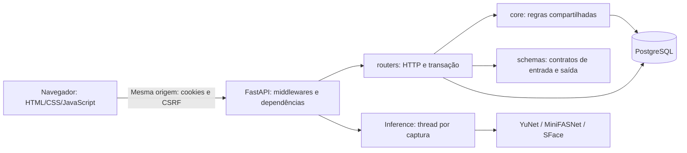

# Arquitetura do sistema

Este documento descreve a organização executável do projeto. [BUSINESS_RULES.md](BUSINESS_RULES.md) define as regras; [ENDPOINTS.md](ENDPOINTS.md), os contratos HTTP; [DATABASE.md](DATABASE.md), a persistência; [AUTH_LAB.md](AUTH_LAB.md), as evidências de validação e seus limites.

## Componentes e fluxo de uma requisição

A API serve `/lab` e seus assets, além dos endpoints `/api/v1`. O frontend usa fragmentos de URL para navegação e não tem build separado. O banco é acessado por SQL parametrizado com asyncpg, sem ORM ou camadas adicionais de serviços/repositórios.

## Organização por responsabilidade

| Local | Responsabilidade e limite |
| --- | --- |
| `app.py` | Registrar routers, handlers e middlewares; preparar e encerrar recursos no lifespan. |
| `core/database.py` | Criar o pool, escolher schema e aplicar migrations; fornecer a dependência `Connection`. |
| `core/authentication.py` | Identificar conta/tentativa, revalidar etapas, emitir credenciais e processar biometria. |
| `core/authorization.py` | Consultar permissões vigentes, preservando restrições institucionais do cofre. |
| `core/accounts.py` | Validar vagas e senhas e compartilhar revogação/temporária entre rotas. |
| `core/laboratory.py` | Conferir equipe/vínculo/estado e compartilhar criação de investigação e entrega. |
| `routers/` | Traduzir contratos HTTP, controlar transações e montar respostas permitidas por área. |
| `schemas/` | Validar corpos/consultas e selecionar projeções de resposta; não conceder acesso. |
| `seed/` | Preparar catálogos e primeiro ADMIN; carga fictícia somente por comando explícito. |
| `exceptions/` e `utils/` | Padronizar erros, datas, envelopes e auditoria correlacionada por requisição. |
| `frontend/` | Apresentar ações autorizadas e tratar navegação/câmera; autorização final permanece na API. |

## Inicialização e persistência

1. O lifespan prepara tokens e o hash de comparação para login desconhecido.
2. Em `real`, carrega os quatro pesos locais antes de abrir o banco; em `simulated`, mantém inferência ausente.
3. Cria o pool, aplica migrations pendentes e executa o bootstrap transacional de catálogos/ADMIN.
4. Disponibiliza os recursos em `app.state` para as requisições.
5. Ao encerrar, aguarda inferência ainda em execução e fecha o pool. Em `ENVIRONMENT=test`, também reseta o schema `test`.

`main.py` é um comando manual de migrations e não inicia o servidor. Todos os ambientes usam o mesmo `DB_NAME`; development/production usam `public`, e test usa `test`. O fixture pytest envolve seus dados em rollback; os testes concorrentes criam schemas aleatórios exclusivos e os removem em `finally`.

## Acesso e fronteiras de autorização

Uma credencial restrita permite somente sua etapa de autenticação. Access exige sessão e conta vigentes e etapas obrigatórias concluídas. As dependências consultam papel/permissão atuais; as regras científicas conferem equipe e vínculo com a investigação.

- N1 edita apenas a tarefa sob sua responsabilidade; colaboradores atuais leem aquela tarefa.
- N2 atua na própria equipe e acompanha metadados dos envios, sem reabrir conteúdo selado.
- N3 consulta o cofre e decide sobre relatório/notícia; não edita a análise ou o original selado.
- ADMIN administra acesso e contas, sem acesso científico automático.
- Visitantes recebem apenas a projeção de notícias PUBLISHED não excluídas.

Menus e flags `can_edit`/`can_submit` orientam a interface; não substituem os controles transacionais da API.

## Transações e concorrência

As transações pertencem às rotas ou ao comando que chama as regras compartilhadas. Helpers que adquirem locks não fazem commit independente. Atualização de negócio e auditoria de sucesso são gravadas juntas.

| Fluxo | Serialização |
| --- | --- |
| Cadastro/posição N2 ou N3 | Advisory lock de cadastros e revalidação da vaga. |
| Bootstrap | Advisory lock próprio para inicializações concorrentes. |
| Login/logout | Contas do contexto em ordem de UUID, com `FOR NO KEY UPDATE`, antes de sessões/tentativas. |
| Refresh/revogação | Sessão antes do token; a leitura inicial sem lock é revalidada sob lock. |
| Alterações científicas | Amostra antes da investigação/dossiê, com estado/vínculo reconsultados. |
| Candidato a responsável/leitor | `FOR SHARE` na conta elegível até terminar a inclusão/atribuição. |

A ordem dos locks evita as inversões reproduzidas nos testes. As constraints complementam a implementação: uma investigação em andamento por amostra, uma entrega por número e vínculos únicos de dossiê/publicação/pedido. Os testes não comprovam ausência de toda condição de corrida sob qualquer carga.

## Histórico científico e decisões

`biological_agents` guarda o cadastro; `validations`, a análise atual; `validation_participants`, os vínculos de leitura. Cada envio preserva `investigation_submissions` com snapshot da equipe. O envio N2 preserva cadastro, equipe, entrega, relatório e notícia no `vault`; a divulgação copia somente os campos públicos para `publications`.

Pedidos N3 podem formar uma cadeia: o dossiê emite um pedido e a próxima investigação o atende. `validation_id` identifica a origem; `request_fulfilled_by_validation_id`, o atendimento. Acompanhamento do envio mostra o pedido emitido por aquele dossiê; a investigação mostra o pedido que a originou.

Exclusão lógica não apaga o histórico nem restaura credenciais consumidas. Mesmo entregas excluídas continuam impedindo alteração do cadastro da amostra.

## Execução de biometria

O navegador envia cinco imagens por multipart. `decode_frame` verifica conteúdo/dimensões, YuNet localiza o rosto, os dois MiniFASNet avaliam PAD e SFace gera o embedding. A comparação é com a conta esperada, sem identificação aberta entre todas as pessoas.

`Inference` executa o trabalho em thread, com uma captura ativa por processo e timeout HTTP de 30 segundos. Timeout não libera a vaga antes de a thread terminar. Isso não é uma fila distribuída entre workers. Hash e comparação Argon2 também executam fora do loop HTTP.

O modo simulado exerce etapas e permissões sem executar os modelos ou produzir vetores. Precisão facial, PAD, câmera física, carga real e implantação HTTPS dependem de validação própria, registrada em [AUTH_LAB.md](AUTH_LAB.md).

## Evolução desta referência

Este arquivo substitui a descrição histórica de atores que atribuía análise ao N2 e envio ao cofre ao N3. O fluxo vigente é N1 prepara/entrega, N2 revisa/envia e N3 decide. A divisão de revisão está em [AMANDA.md](AMANDA.md), [JOAO.md](JOAO.md) e [LUIZ.md](LUIZ.md).
