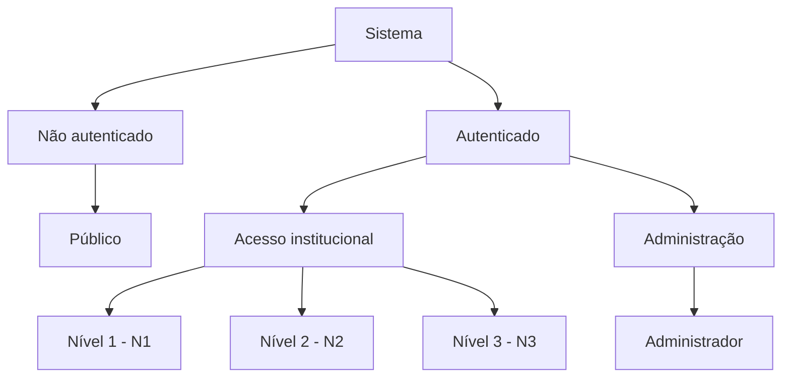

# Casos de Uso - Sistema de Biossegurança Ambiental

## 1. Atores do Sistema

O sistema possui dois tipos principais de usuários: não autenticados e autenticados.

## 2. Descrição dos Atores

| Ator | Descrição |
|---|---|
| Público | Usuário não autenticado com acesso às informações públicas. |
| N1 | Usuário institucional com permissões básicas de consulta. |
| N2 | Usuário institucional com permissões técnicas de análise e edição. |
| N3 | Usuário institucional com permissões de direção e aprovação de relatórios. |
| Administrador | Responsável pelo gerenciamento de usuários, níveis e permissões. |

## 3. Casos de Uso

### UC01 - Consultar informações públicas
**Ator:** Público

**Pré-condição:** Nenhuma autenticação necessária.

**Fluxo principal:**
1. O usuário acessa o sistema.
2. O sistema apresenta as informações públicas.
3. O usuário consulta os dados permitidos.

### UC02 - Autenticar usuário
**Ator:** N1, N2, N3 ou Administrador

**Pré-condição:** Usuário cadastrado e ativo.

**Fluxo principal:**
1. O usuário informa suas credenciais.
2. O sistema valida a identidade.
3. O sistema verifica o nível de acesso.
4. O usuário é direcionado às funcionalidades autorizadas.

### UC03 - Consultar registros concluídos
**Ator:** N1, N2 e N3

**Pré-condição:** Usuário autenticado e autorizado.

**Fluxo principal:**
1. O usuário acessa a área institucional.
2. O sistema lista os registros permitidos.
3. O usuário consulta os detalhes de um registro.

### UC04 - Realizar análises técnicas
**Ator:** N2

**Pré-condição:** Usuário autenticado com permissão técnica.

**Fluxo principal:**
1. O usuário acessa os registros em desenvolvimento.
2. Seleciona um registro.
3. Registra ou atualiza as informações da análise.
4. O sistema valida e salva as alterações.

### UC05 - Encaminhar relatório ao cofre
**Ator:** N3

**Pré-condição:** Relatório concluído e usuário autorizado.

**Fluxo principal:**
1. O usuário acessa os relatórios disponíveis.
2. Seleciona o relatório para encaminhamento.
3. Confirma a operação.
4. O sistema registra o envio ao cofre.

### UC06 - Administrar usuários e permissões
**Ator:** Administrador

**Pré-condição:** Administrador autenticado.

**Fluxo principal:**
1. O administrador acessa o painel administrativo.
2. Seleciona usuários, perfis ou permissões.
3. Realiza a operação autorizada.
4. O sistema valida e registra a alteração.
