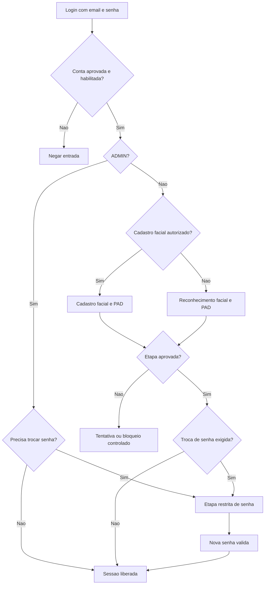
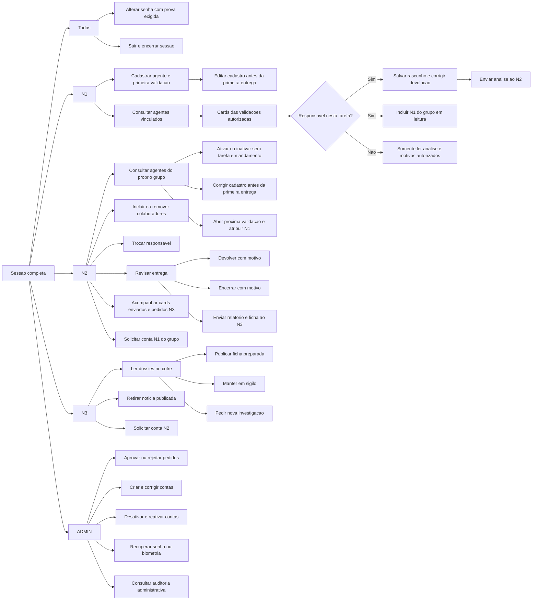
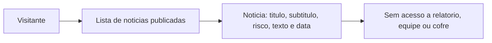
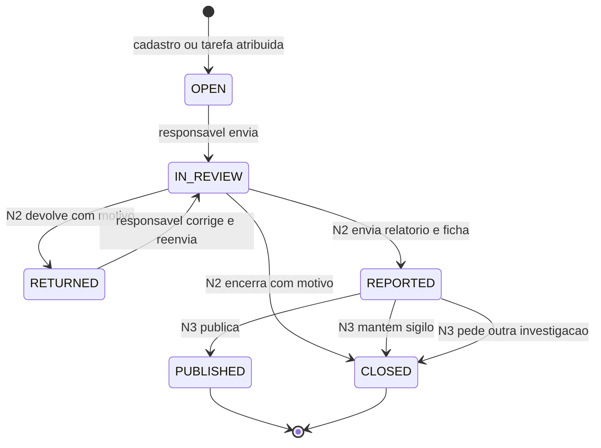
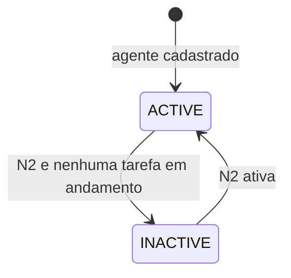

# Uma pessoa entra e o trabalho percorre o sistema

Este exemplo é fictício e serve para visualizar as telas, campos e regras, não para simular um diagnóstico real. Não atribuímos dados científicos verdadeiros à COVID-19. O banco e as rotas ainda serão implementados. Leia junto com [Como funciona o sistema](BUSINESS_RULES.md), [Endpoints](ENDPOINTS.md) e [Tabelas](DATABASE_TARGET.md).

## 1. Quem participa do exemplo

Ana: N1 responsável da Equipe A. Bruno: N1 colaborador da mesma equipe. Carla: outro N1 da Equipe A. Diego: único N2 habilitado da Equipe A. Marina: única N3 habilitada. Administrador: administra contas, sem acesso científico. Visitante: consulta somente notícias autorizadas. Equipe B não participa nem vê os registros da Equipe A.

## 2. Como Ana recebe a conta

Diego preenche Solicitar acesso: nome “Ana Lima”, email “ana@laboratorio.exemplo”, senha temporária escolhida fora deste documento. O backend define N1/Equipe A. `POST /api/v1/access-requests` cria pedido pendente, não usuário.

ADMIN aprova em `POST /api/v1/access-requests/{id}/approve`. Conta nasce pendente de ativação, senha vale 24 horas. Diego entrega a senha manualmente. O sistema não envia email. Os emails deste exemplo são fictícios; o catálogo real de domínios não será filtrado no MVP.

Ana abre Login. A página prepara CSRF e envia email/senha a `POST /api/v1/auth/login`. Recebe cookie restrito de cadastro facial, não access/refresh. Captura a face; servidor exige PAD e cadastro autorizado. Em `POST /api/v1/auth/biometric/enroll` a face é guardada criptografada e a etapa muda para definir senha por mais cinco minutos. Ana envia nova senha/confirmacão a `POST /api/v1/auth/password/complete`. Só agora nasce sessão de até 24 horas, com access de até 15 minutos e refresh em cookies inacessíveis ao JavaScript.

Se Ana parar na senha e a temporária vencer, ADMIN revalida a MESMA temporária. Como já existe face, Ana passa por reconhecimento/PAD e volta à definição de senha, sem cadastrar outro rosto. Em login normal, sempre senha → face/PAD → sessão. ADMIN dispensa face.



## 3. Depois do login: árvore de casos de uso

Esta árvore mostra ações possíveis, não páginas duplicadas por nível. N1 responsável e colaborador são situações do mesmo papel N1; um usuário pode editar uma tarefa e apenas ler outra.



Público não passa pelo login para notícias:



## 4. Ana cadastra o agente

Na tela Novo agente, Ana informa:

| Campo na tela | Exemplo preenchido |
| --- | --- |
| Identificação provisória | Amostra respiratória AR-01 |
| Tipo de material | Amostra de secreção respiratória |
| Local da coleta | Unidade fictícia Norte, sala de coleta 2 |
| Data da coleta | 01/10/2026 |
| Observações iniciais | Amostra recebida para investigação de um achado ainda não identificado. |
| Motivo da investigação | Verificar se o material apresenta características que justificam investigação adicional. |
| Informações conhecidas antes da análise | Origem informada no cadastro de coleta; sem identificação confirmada do agente. |

Nenhum campo exige saber o nome científico ou a especialidade. Backend gera código, grupo, autoria/datas e estado ATIVO. Ana não escolhe grupo, dono ou estado. O exemplo usa terminologia respiratória, mas todos os achados e percentuais adiante são inventados para testar o fluxo.

Exemplo da chamada (sem cookies/CSRF neste trecho ilustrativo):

```json
{
  "provisional_label": "Amostra respiratória AR-01",
  "material_type": "Amostra de secreção respiratória",
  "collection_location": "Unidade fictícia Norte, sala de coleta 2",
  "collected_on": "2026-10-01",
  "initial_observations": "Amostra recebida para investigação de um achado ainda não identificado.",
  "investigation_reason": "Verificar se o material apresenta características que justificam investigação adicional.",
  "known_information": "Origem informada no cadastro de coleta; sem identificação confirmada do agente."
}
```

`POST /api/v1/biological-agents` retorna 201 com cadastro e primeira validação OPEN. IDs reais são UUIDs; neste texto usamos A-001 e V-001 só como apelidos. Não são valores válidos para enviar como UUID.

Na página do agente há card V-001, responsável Ana, situação Rascunho. Ana já pode salvar análise; não precisa clicar para criar essa primeira tarefa. Se editar local/material antes do envio, permitido. Depois da primeira entrega, cadastro não é mais editado.

## 5. Ana inclui Bruno e prepara a análise

Ana seleciona Bruno entre N1 ativos da Equipe A. `POST /api/v1/validations/{id}/participants` cria vínculo somente de leitura. Bruno vê A-001 e V-001, sem editor, botão de envio ou compartilhamento. Não vê outro card por ter sido incluído neste.

Ana preenche:

| Campo | Exemplo fictício |
| --- | --- |
| Avaliações realizadas | Conferência do cadastro, registro das condições recebidas e revisão das observações da equipe. |
| Resultados observados | Os registros iniciais não permitem uma identificação conclusiva; há dados suficientes para justificar avaliação adicional. |
| Parecer técnico | Resultado inconclusivo nesta etapa; a interpretação depende de novas informações. |
| Recomendação | Complementar os registros antes de emitir conclusão final. |
| Risco estimado | Não determinado: campo vazio, enviado como null. |

Salvar rascunho chama PATCH da análise e mantém OPEN. Enviar chama POST submit, confere quatro textos, grava entrega 1 com Ana/Bruno e muda para IN_REVIEW. Formulário fica bloqueado. Se alguém tentar incluir/remover colaboradores nesse estado, a API rejeita.

## 6. Diego devolve e a equipe corrige

Diego recebe V-001 em Revisões. Não edita o texto de Ana. Escolhe Devolver e informa “Explique melhor quais dados ainda faltam e como foram conferidas as informações de coleta.” Motivo obrigatório até 1.500; `POST /validations/{id}/return` muda para RETURNED.

Ana e Bruno veem o motivo; só Ana corrige. A entrega 1 continua preservada. Se Diego remover Bruno agora, Bruno perde vínculo atual mas continua no histórico da entrega 1. Ana pode incluir Carla do grupo em leitura; não pode remover Bruno por conta própria.

Se Diego trocar responsável por Carla nesse estado, Carla vira única editora e Ana fica como colaboradora. Para simplificar o exemplo principal, manteremos Ana responsável.

Ana complementa os textos e reenvia. A entrega 2 registra equipe atual, com Ana/Carla caso Bruno tenha sido removido e Carla incluída. Passa novamente a IN_REVIEW. Não foi criado outro agente nem outra validação: são duas entregas da mesma tarefa.

## 7. Duas saídas durante a revisão

### Saída A: encerrar sem N3

Diego escolhe Encerrar e escreve “A investigação foi concluída sem necessidade de encaminhamento ministerial neste ciclo.” Motivo até 1.500 disponível a Ana e colaboradores atuais. V-001 passa a CLOSED, sem criar dossiê. Agente continua ATIVO. Diego pode atribuir V-002 a Carla, e Ana não vê V-002 automaticamente.

### Saída B: enviar conclusão e ficha ao N3

Nesta continuação alternativa, Diego escolhe Enviar ao N3 e preenche:

| Campo | Exemplo fictício |
| --- | --- |
| Título interno | Conclusão da investigação AR-01 |
| Conclusão final | A equipe concluiu a etapa prevista e registrou os achados que fundamentam o encaminhamento. Este texto é fictício e serve apenas para demonstrar o relatório. |
| Percentual final de risco | 35,00 — número inventado para o exemplo da APS. |
| Título público | Laboratório conclui investigação de amostra respiratória |
| Subtítulo | Equipe finaliza etapa de avaliação e mantém acompanhamento |
| Categoria pública | Moderado — escolha do N2, não cálculo de 35%. |
| Corpo da notícia | O laboratório concluiu uma etapa de investigação de uma amostra respiratória. [Novo parágrafo] Os registros serão utilizados para orientar o acompanhamento previsto pela equipe. Este exemplo não descreve um evento real. |

`POST /validations/{id}/report/send` exige todos os campos, exceto subtítulo. Cria dossiê com entrega 2, relatório e ficha. V-001 passa para REPORTED. A vaga segue ocupada.

Diego passa a ver no menu Enviadas ao N3 um card “Conclusão da investigação AR-01 — Amostra respiratória AR-01 — Aguardando N3 — protocolo”. Não pode reabrir o relatório/ficha enviados. Ana/colaboradores mantêm leitura de suas análises autorizadas, sem cofre ministerial.

## 8. O que Marina pode decidir

Estas são alternativas, não decisões aplicadas juntas ao mesmo dossiê.

| Decisão | O que acontece | Quem consulta o motivo |
| --- | --- | --- |
| Publicar | Copia ficha para notícia pública; V-001 fica PUBLISHED e libera próxima tarefa. | Não exige motivo de publicação. |
| Manter em sigilo | Registra motivo e fecha V-001 em CLOSED. Não cria notícia; libera próxima tarefa. | Só N3; Diego vê situação. |
| Pedir nova investigação | Registra motivo e fecha V-001; Diego recebe pedido para atribuir V-002. | N3, N2 do grupo e equipe de V-002, sem cofre. |

Exemplo de pedido: “Complementar a investigação com os pontos de acompanhamento descritos no pedido.” Diego vê esse texto no card e, na página A-001, escolhe Carla para nova tarefa. Vincula o pedido a V-002; ele passa a atendido. Carla começa outro rascunho e pode incluir Ana em leitura. Não se edita o dossiê anterior, não se cria outra amostra e não se abre uma segunda tarefa em andamento.

Se a amostra foi inativada após o fechamento, Diego precisa ativá-la antes de atribuir V-002. Se Diego for substituído, o novo N2 da Equipe A vê o pedido do grupo, preservando autoria anterior.

## 9. Como a notícia aparece

A página pública monta este layout a partir dos campos aprovados:

> **Laboratório conclui investigação de amostra respiratória**
>
> Equipe finaliza etapa de avaliação e mantém acompanhamento
>
> Classificação: Moderado · Publicado em: data gerada pelo sistema
>
> O laboratório concluiu uma etapa de investigação de uma amostra respiratória.
>
> Os registros serão utilizados para orientar o acompanhamento previsto pela equipe. Este exemplo não descreve um evento real.

Percentual 35, parecer, nomes, local exato e protocolo interno NÃO aparecem. Se Marina retirar a notícia, informa motivo somente N3; público deixa de encontrá-la, histórico interno fica preservado. Não há edição/substituição da notícia. Inativar A-001 não retira notícia automaticamente.

## 10. Movimento dos estados



CLOSED/PUBLISHED liberam uma NOVA tarefa pelo N2, não reabrem a mesma. Withdrawn é estado da publicação, não da validação.



## 11. Cenários que devem falhar

- Bruno tenta editar/enviar ou compartilhar V-001: negado.
- N2 da Equipe B tenta ler A-001 ou incluir seu N1: não revela o recurso.
- N1 cria V-002: negado; tarefa seguinte é N2.
- Duas chamadas tentam criar próxima tarefa simultaneamente: só uma consegue.
- Diego tenta inativar agente com V-001 REPORTED: conflito.
- Diego tenta encerrar OPEN/RETURNED ou mexer no dossiê selado: negado.
- N3 tenta publicar e pedir outra investigação simultaneamente: uma decisão vence; outra recebe conflito.
- ADMIN tenta ler motivo de sigilo pelo log: conteúdo não é retornado.
- Token restrito tenta ler lista de agentes: negado.
- Cookie access expirou e refresh válido: renovar e repetir chamada uma vez; refresh revogado/expirado leva ao Login.
- Tentativa de cadastro de face sem autorização ou com token antigo: negada.

Esses exemplos são objetivos para os testes futuros, não testes já executados.
